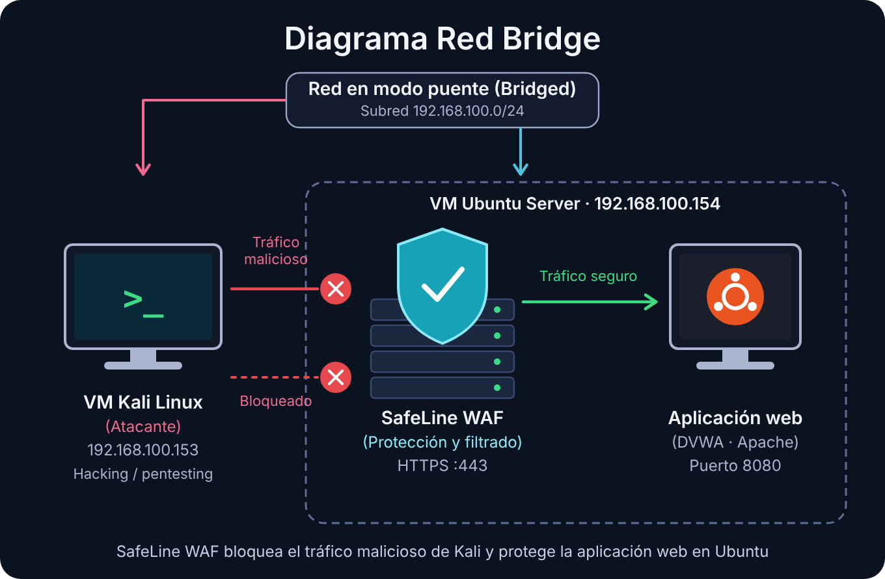

## 1.🌐 Topología y Segmentación de Red
La configuración de red consta de 2 máquinas virtuales en conexión modo puente: una máquina kali-limux (atacante) y una máquina ubuntu, donde en esta última se estará ejecutando la aplicación web y el WAF. La Figura 1 ilustra esto.

<figure style="margin: 2rem auto; max-width: 700px;">
  
  <figcaption style="text-align: center; font-style: italic;">
    Figura 1. Red en modo puente con Kali Linux (192.168.100.153), SafeLine WAF y aplicación web en Ubuntu (192.168.100.154).
  </figcaption>
</figure>

## 2. Asignación de hardware virtual
- **Máquina Ubuntu:** 
  - vCPU: 2-4
  - RAM: 6 GB
  - Almacenamiento: 30 GB VDI
  - Tipo de conexión: Modo puente 
- **Kali-Linux:** 
  - vCPU: 2
  - RAM: 6 GB
  - Almacenamiento: 40 GB VDI
  - Tipo de conexión: Modo puente.

