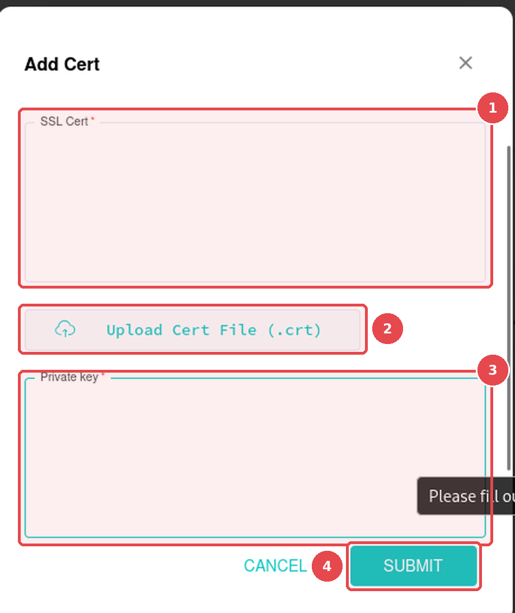
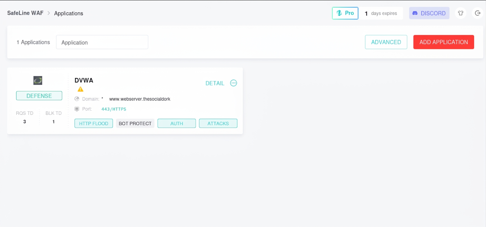

## Instalación de herrammientas
Primero se comenzarán instalando las herramientas necesarias para la implementación del servidor web. En este caso se utilizará un servior web apache, por lo que se requerirá instalar dicho servidor, el lenguaje de back-end a utilizar (php en este caso), los conectores para la comunicación entre el lenguaje de programación y la base de datos y el propio servidor de base de datos. Esto se hace con el siguiente comando.

```bash
sudo apt-get install -y apache2 php php-mysql mysql-server
```
Luego se recomienda ejecutar el siguiente comando, el cual permite establecer una contraseña para el usuario root en el servidor de base de datos, además de proporcionar otras capas de seguridad.

```bash
sudo mysql_secure_installation
```


## Configuración de la aplicación web vulnerable
Primero se debe clonar el repositorio de github de la app vulnerable.
```bash
cd /var/www/html
sudo git clone https://github.com/digininja/DVWA.git
```
Si no se tiene git instalado, se debe instalar con el siguiente comando;
```bash
sudo apt-get install -y git
```
Ahora se debe cambiar el propietario del directorio DVWA y dejar al usuario www-data. además de otorgarle los permisos necesarios a dicho usuario en ese directorio.
```bash
sudo chown -R www-data:www-data DVWA
sudo chmod -R 755 DVWA
```
Ahora se debe editar el archivo de configuración de la aplicación web ubicado en la ruta DVWA/config/config.inc.php y actualizar los valores de las variables a los de la tabla.

<div align="center">

| Variable | Valor |
|:--------:|:-----:|
| `$DBMS`  | `MySQL` |
| `$db`    | `dvwa` |
| `$user`  | `dvwa_user` |
| `$pass`  | `p@ssw0rd` |
| `$host`  | `localhost` |

</div>

Luego se debe crear una nueva base de datos y un nuevo usuario en el servidor de base de datos mysql al que se le otorgarán todos los permisos en la base de datos creada anteriormente (DVWA) y se le concederán a nivel local.

```bash
sudo mysql -u root -p
CREATE DATABASE dvwa;
CREATE USER 'dvwa_user'@'localhost' IDENTIFIED BY 'p@ssw0rd';
GRANT ALL ON dvwa.* TO 'dvwa_user'@'localhost';
FLUSH PRIVILEGES;
exit;
```
Ahora se debe navegar a http://<Ubuntu IP>/DVWA/setup.php y clickear en resetear base de datos.

## Cambiar el puerto de escucha de la aplicación web
Por defecto, el servidor Apache escucha conexiones en el puerto 80, por lo que se debe cambiar el puerto de escucha para dejar libre ese puerto para que el waf pueda recibir las peticiones http. Esto se puede hacer modificando el archivo /etc/apache2/ports.conf y cambiar de Listen 80 a Listen 8080. Luego se debe modificar el archivo /etc/apache2/sites-available/000-default.conf y dejar configurado <VirtualHost *:8080>. Por último, se debe reiniciar apache con el comando sudo systemctl restart apache2 para que se aplique la configuración anterior.

## Añadir valores personalizados a la base de datos de la aplicación web
Se pueden añadir valores de usuario y contraseña a la base de datos iniciando sesión con el usuario root y entrando a la base de datos creada DVWA.
```bash
sudo mysql -u root -p
USE dvwa;
```
Luego se pueden añadir los valores,

```bash
CREATE TABLE test_users (
id INT NOT NULL AUTO_INCREMENT,
username VARCHAR(50) NOT NULL,
password VARCHAR(50) NOT NULL,
PRIMARY KEY (id)
);
INSERT INTO test_users (username, password) VALUES
('alice', 'alice123'),
('bob', 'bob123'),
('admin', 'admin123');
exit;
```
## Creación de certificado SSL para tráfico https
Se puede crear y hacer uso de un cerificado ssl para cifrado de tráfico http. Para ello primero se crea una clave privada RSA.

```bash
# Genera una clave privada RSA de 4096 bits y la guarda en el archivo priv.key
openssl genrsa -out priv.key 4096[cite: 2]
```
Luego se genera una solicitud de firma de certificado con dicha clave privada.
```bash
# Genera una Solicitud de Firma de Certificado (CSR) utilizando la clave privada existente (priv.key) y la guarda en el archivo priv.csr
openssl req -new -key priv.key -out priv.csr[cite: 3]
```
Luego se genera un certificado autofirmado con los dos archivos generados anteriormente.
```bash
# Genera un certificado autofirmado (priv.crt) válido por 365 días a partir de la solicitud (priv.csr) usando la clave privada (priv.key)
openssl x509 -req -days 365 -in priv.csr -signkey priv.key -out priv.crt[cite: 4]
```
## Instalación y configuración del WAF
Ingresar al siguiente sitio web https://ly.safepoint.cloud/zfYZD3l y selecciona **"Install"** (Instalar).

SafeLine WAF normalmente ofrece un script de instalación automática o un método de instalación manual. Seguir estos pasos para la instalación automática:

1. Ejecutar el siguiente comando en la línea de comandos de Ubuntu:

   ```bash
   bash -c "$(curl -fsSLk https://waf.chaitin.com/release/latest/manager.sh)" -- --en
   ```

2. Seguir las indicaciones en pantalla para completar la instalación.
3. Se proporcionará un usuario y una contraseña de administrador, además de la URL para acceder a SafeLine, normalmente en el puerto 9443.
4. Una vez que se inicie sesión, se recomienda actualizar a una licencia PRO. Se puede elegir una prueba de 7 días desde https://ly.safepoint.cloud/zfYZD3l, lo que equivale a $1

### Importar los certificados autofirmados al WAF
Para que el tráfico hacia la página web viaje por https, se deben importar el archivo de certificado y el archivo clave generados anteriormente. para eso basta con copiar el contenido de los siguientes archivos /etc/ssl/dvwa/dvwa.crt y /etc/ssl/dvwa/dvwa.key en la ruta Settings -> SSL Cert -> Add Cert y añadir cada contenido de esos archivos en las casillas que se muestran en la figura 2. 

<div align="center">



<p><em>Figura 1. Ventana "Add Cert" de SafeLine WAF: (1) SSL Cert, (2) Upload Cert File, (3) Private key y (4) Submit.</em></p>

</div>

### Añadir la aplicación web vulnerable al WAF
Para añadir la aplicación web al WAF, se debe ir a la opción de Applications en el WAF y seleccionar la opción de Add application tal como se muestra en la figura 2.

<div align="center">



<p><em>Figura 2: Interfaz web de WAF safeline.</em></p>

</div>


