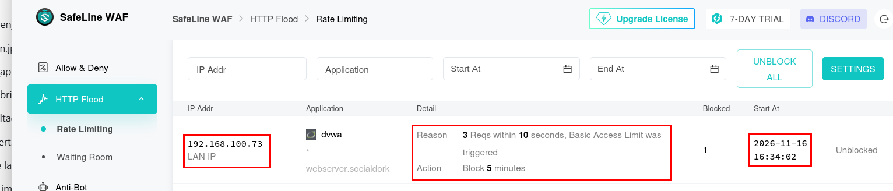
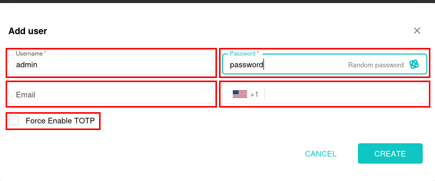
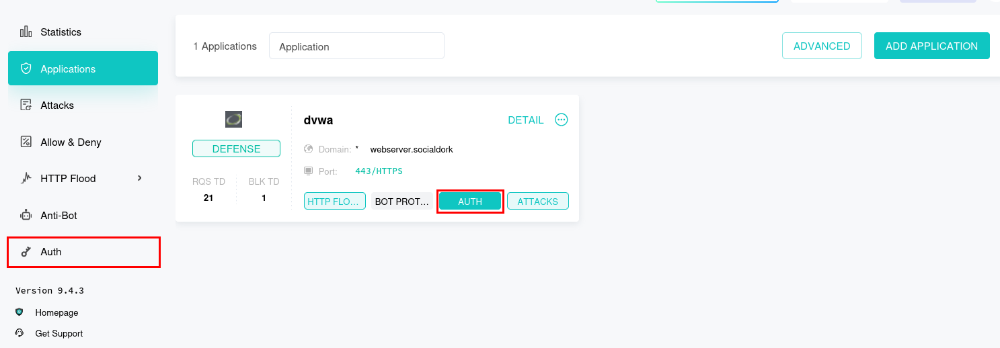
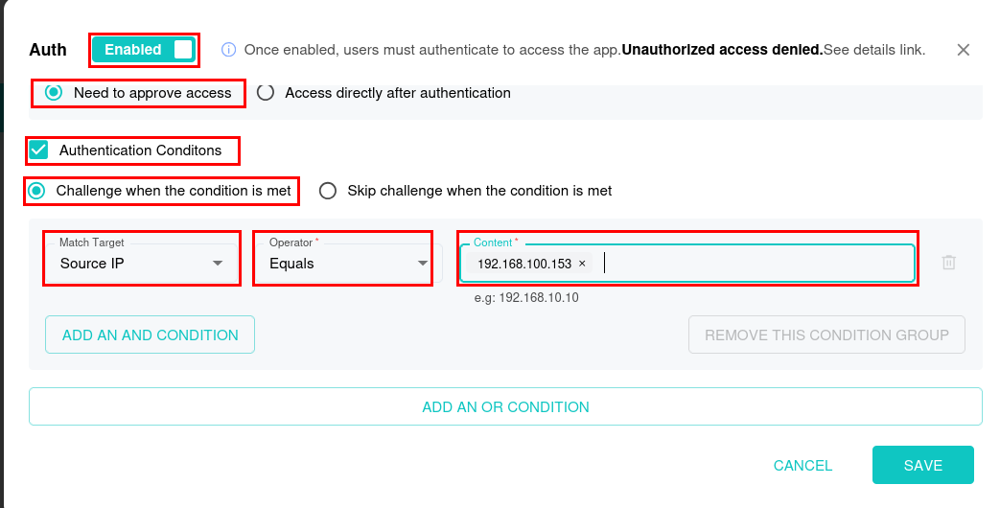
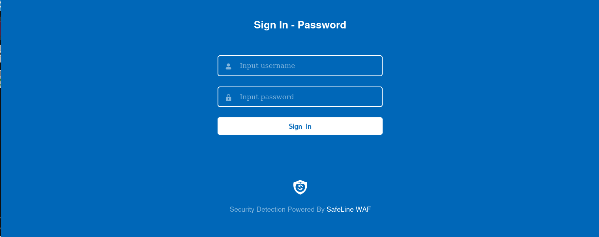
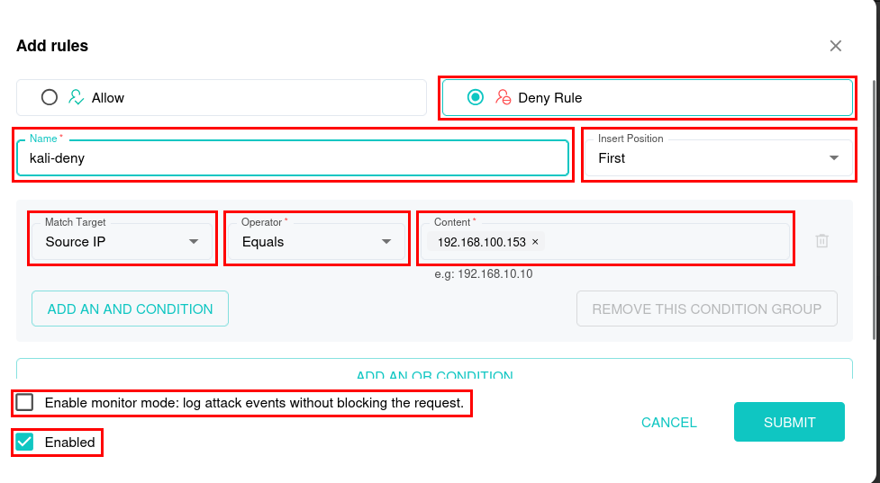

## Implementación de reglas en el WAF y comprobación
En esta sección se nombrarán las reglas configuradas en en WAF junto con la comprobación de la aplicación de dichas reglass al ejecutar pruebas en la aplicación web vulnerable.

#### Protección de limitación de tasa
Se comenzará implementando un límite de peticiones para una misma IP de origen. La figura 1 muestra la regla implementada en el WAF para que una IP se bloquee por 5 minutos tras 3 peticiones en la páquina web en menos de 10 segundos. Para esto se debe ir a la sección de HTTP Flood -> Access Limiting del WAF.

  
   
  <em>Figura 1. Ventana "Edit rules" con los parámetros de la regla resaltados en rojo.</em>

Ahora, al implementar la regla, se puede entrar a la aplicación web configurada y probar seleccionar varios apartados de ella. Cuando se seleccionan 2 apartados aparece la siguiente advertencia.

  
   
  <em>Figura 2. Página de bloqueo "Access Forbidden" mostrada por SafeLine WAF.</em>

Luego, al ingresar a la interfaz del WAF, se verá en los registros que la ip de la máquina kali fue bloqueada.

  
   
  <em>Figura 3. Registro de Rate Limiting en SafeLine WAF con la IP bloqueada resaltada en rojo.</em>

### Método de autenticación por contraseña para ingreso en la aplicación web
También es posible configurar un método de autenticación por credenciales antes de que el waf redirija la petición al servidor back-end. esto se hace en las opciones Auth-> Settings -> Add User en el waf. En este caso se añadieron las credenciales admin-password solo para fines de prueba.

  
   
  <em>Figura 4. Formulario "Add user" con los campos de configuración resaltados en rojo.</em>

Se puede aplicar ese método de autenticación en la aplicación web dirigiéndose a la opción Auth dentro de la aplicación web añadida anteriormente.

  
   
  <em>Figura 5. Panel "Applications" de SafeLine WAF con la opción Auth resaltada en rojo.</em>

Luego, dentro de esa opción se debe habilitar Auth y elegir el método de autenticación, que en este caso se eligió el método de credenciales. También es posible seleccionar condiciones tales como la ip de las máquinas a las que se les solicitará autenticación. En este caso se seleccionó esa opción y se ingresó la IP de la máquina kali tal como se muestra en la figura 6.

  
   
  <em>Figura 6. Configuración del módulo Auth en SafeLine WAF con las opciones activas resaltadas en rojo.</em>

Si ahora se navega hacia la aplicación web, se verá una pestaña como la siguiente, donde el WAF solo solicitará la página en el back-end si se proporcionan las credenciales correctas (las que se configuraron anteriormente).

  
   
  <em>Figura 7. Página de autenticación "Sign In - Password" de SafeLine WAF.</em>

### Configuración de regla personalizada
También es posible configurar reglas personalizadas en el WAF en la sección de Allow and Deny -> Custom Rules. En este caso se añadió una regla simple de denegación por IP como se ilustra en la figura 8. Sin embargo, es posible seguir añadiendo condicionales a la regla en base a lo que se requiera.

  
   
  <em>Figura 8. Creación de la regla de denegación "kali-deny" en SafeLine WAF.</em>

 Ahora si se intenta acceder a la aplicación web, se verá algo como esto.

 

  
   
  <em>Figura 9. Página "Access Forbidden" mostrada por SafeLine WAF al aplicarse la regla de denegación.</em>

Lo que confirma que la regla se aplicó correctamente.

### Protección del WAF contra SQL injection
La aplicación web que se implementó (DVWA) se hizo vulnerable a propósito con el fin de aprender las diferentes técnicas de pentesting en aplicaciones web. Sin embargo, debido a que el WAF por defecto trae protección contra diferentes tipos de ataques de inyección, al intentar realizar una inyección sql en un campo de inyección (ver figura 10), el WAF no permitirá el envió al back-end. Tal como se ilustra en la figura 11. que despúes de intentar una inyección, apareció un aviso de que el WAF bloqueó el acceso. 

