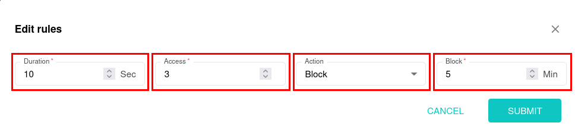

## Implementación de reglas en el WAF y comprobación
En esta sección se nombrarán las reglas configuradas en en WAF junto con la comprobación de la aplicación de dichas reglass al ejecutar pruebas en la aplicación web vulnerable.

#### Protección de limitación de tasa
Se comenzará implementando un límite de peticiones para una misma IP de origen. La figura 1 muestra la regla implementada en el WAF para que una IP se bloquee por 5 minutos tras 3 peticiones en la páquina web en menos de 10 segundos. Para esto se debe ir a la sección de HTTP Flood -> Access Limiting del WAF.

  
   
  <em>Figura 1. Ventana "Edit rules" con los parámetros de la regla resaltados en rojo.</em>

Ahora, al implementar la regla, se puede entrar a la aplicación web configurada y probar seleccionar varios apartados de ella. Cuando se seleccionan 2 apartados aparece la siguiente advertencia.

